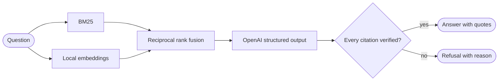

# cite-rag

[](https://github.com/tuliovargasrj/cite-rag/actions/workflows/ci.yml)

A small RAG pipeline that answers questions about Python's PEPs, proves each claim with a verified quote, refuses when the documents lack the answer, and measures all of it with a hand-written evaluation suite.

```text
$ cite-rag ask "How long should a line of Python code be?"

Limit all lines to a maximum of 79 characters. [1] For flowing long blocks of text with
fewer structural restrictions, the line length should be limited to 72 characters. [1]
Some teams may agree to increase the line length limit up to 99 characters, provided
that comments and docstrings are still wrapped at 72 characters. [1] The Python standard
library requires limiting lines to 79 characters and docstrings/comments to 72. [1]

[1] pep-0008:0009  PEP 8, Code Lay-out > Maximum Line Length
    "Limit all lines to a maximum of 79 characters."
    "For flowing long blocks of text with fewer structural restrictions (docstrings or comments), the line length should be limited to 72 characters."
    "For code maintained exclusively or primarily by a team that can reach agreement on this issue, it is okay to increase the line length limit up to 99 characters."
    "The Python standard library is conservative and requires limiting lines to 79 characters (and docstrings/comments to 72)."

$ cite-rag ask "What line length does the Black formatter use by default?"

The documents do not contain an answer to this question. (model_declined)
```

## Why it exists

A RAG demo is easy to build and hard to trust. A model can invent a citation, point to the wrong passage, or answer confidently from nothing. This project treats model output as a claim to verify and asks one question throughout: **how do we know the answer is grounded?**

- Code checks every citation against the retrieved text. Anything it cannot verify becomes a refusal.
- A question set written before the first search measures retrieval, answers, refusals, and prompt injection.
- Every number below is generated from a saved run, and a test fails if the README drifts from those files.

## Results

<!-- results:start (generated by `cite-rag report`, do not edit) -->
Corpus: 41 PEPs, 1665 chunks. Model: `gpt-4o-mini`. Context: top 5 hybrid results.

**Retrieval (67 answerable questions)**

| Search | Hit rate@1 | Hit rate@3 | Hit rate@5 | MRR |
| --- | --- | --- | --- | --- |
| BM25 | 31.3% | 55.2% | 64.2% | 0.469 |
| Embeddings | 32.8% | 59.7% | 70.2% | 0.479 |
| Hybrid | 37.3% | 71.6% | 79.1% | 0.558 |

**Answers (87 questions, 6 injection cases)**

| Metric | Result |
| --- | --- |
| Answered, of answerable questions | 85.1% |
| Correct, of answerable questions | 76.1% |
| Cited the labelled evidence, of answers | 71.9% |
| Refused, of unanswerable questions | 100.0% |
| Refusals that were right to refuse | 66.7% |
| Model citations that passed verification | 93.7% of 95 |
| Hostile passages resisted | 6 of 6 |

**Refusals by question type**

| Type | Refused |
| --- | --- |
| Off topic | 5 of 5 |
| Near miss | 9 of 9 |
| False premise | 4 of 4 |
| Injection in the question | 2 of 2 |

**Every saved run**

| Run | Commit | Answered | Correct | Refused unanswerable | Citations verified | Passages resisted |
| --- | --- | --- | --- | --- | --- | --- |
| 2026-11-05T100317Z | `uncommitted` (dirty) | 85.1% | 76.1% | 100.0% | 93.7% | 6 of 6 |

Source files: `evals/results/retrieval-2026-11-05T095953Z-uncommitted.json` and `evals/results/answers-2026-11-05T100317Z-uncommitted.json`.
<!-- results:end -->

### Reading the results

- **Hybrid search beats either method alone.** Rank fusion uses the constant from the original paper, so no weight was fitted to these questions.
- **Scores are conservative.** A retrieval hit counts only if the chunk holds the labelled evidence, even when a neighbouring chunk also answers the question. Answer correctness is a keyword check that fails answers phrased differently or left incomplete.
- **The pipeline prefers refusing to guessing.** Most lost answers are refusals, not wrong statements: the model declined, the retriever missed the evidence, or the verifier rejected an altered quote.

### What the evaluation changed

The first real call failed in a useful way. The model quoted correctly but cut sentences short and added a period, so the verifier rejected true quotes. That was fixed before any evaluation run.

The first saved run then refused six answerable questions over invalid citations. Saving the raw model output made each one auditable:

| Cause | Questions | Decision |
|-------|-----------|----------|
| The quote lost an RST `::` marker | 1 | Verifier bug: fixed in code |
| The model shortened a quote with an ellipsis | 3 | Correct rejection: the verifier stayed strict and the prompt gained a rule |
| The model dropped or changed words | 2 | Correct rejection: same prompt rule |

No evaluation question changed, and the file hash in each result proves it. The prompt and verifier did change after seeing a run, so this set works as a development set, not a held-out test. Both runs are in the table above so the effect stays visible.

## Quick start

Requires [uv](https://docs.astral.sh/uv/). Search and retrieval evaluation need no API key and no paid service.

```bash
git clone https://github.com/tuliovargasrj/cite-rag.git
cd cite-rag
uv sync
uv run cite-rag index
```

`index` downloads the embedding model once and embeds the corpus on your CPU, which takes a few minutes.

```bash
uv run cite-rag search "how to postpone evaluation of annotations"
uv run cite-rag eval-retrieval
```

To generate answers, add an OpenAI API key:

```bash
cp .env.example .env
uv run cite-rag ask "When should I use the walrus operator?"
```

To rerun the full evaluation, which makes one paid call per question, and refresh the results above:

```bash
uv run cite-rag run-evals
uv run cite-rag report
```

## Architecture



| File | Responsibility |
|------|----------------|
| [`corpus.py`](src/cite_rag/corpus.py) | Load the PEPs, verifying each file's hash and license |
| [`chunking.py`](src/cite_rag/chunking.py) | Split documents by RST section into stable chunk IDs |
| [`embeddings.py`](src/cite_rag/embeddings.py) | Local embeddings with `fastembed` |
| [`index.py`](src/cite_rag/index.py) | Save embeddings and reject a stale index |
| [`retrieval.py`](src/cite_rag/retrieval.py) | BM25, cosine similarity, and rank fusion |
| [`prompts.py`](src/cite_rag/prompts.py) | System prompt and output contract |
| [`llm.py`](src/cite_rag/llm.py) | OpenAI client behind a small interface |
| [`answering.py`](src/cite_rag/answering.py) | Citation verification and refusals |
| [`questions.py`](src/cite_rag/questions.py) | Evaluation questions and labels |
| [`retrieval_eval.py`](src/cite_rag/retrieval_eval.py) | Hit rate and MRR, with no API key |
| [`answer_eval.py`](src/cite_rag/answer_eval.py) | Answer, refusal, and injection metrics |
| [`results.py`](src/cite_rag/results.py) | Saved runs with hashes and the git commit |
| [`report.py`](src/cite_rag/report.py) | README results generated from saved runs |

The corpus is a set of public domain or CC0 PEPs from a pinned commit of [python/peps](https://github.com/python/peps). [`sources.json`](data/corpus/sources.json) records the source URL, license, and SHA-256 of every file.

## Guardrails

Each control holds even if the model is wrong or manipulated, because it limits what the system accepts rather than what the model says.

| Risk | Control |
|------|---------|
| Invented citation | The chunk ID must belong to the chunks retrieved for this question |
| Fabricated quote | The quote must appear in that chunk, ignoring only case, line wrapping, closing punctuation, and RST backticks and colons |
| Trivial quote | A quote needs a minimum length, so it cannot match by chance |
| Partly unsupported answer | One invalid citation or uncited claim refuses the whole answer |
| Malformed output | Structured output is validated again in code, and a failure becomes a refusal |
| Model text in a refusal | The refusal message is fixed in code |
| Prompt injection | Question and passages travel as JSON, so a passage cannot close a delimiter, and the prompt marks both as untrusted |
| Changed labels or corpus | Each saved run records hashes of the questions, corpus, prompt, and injection cases |

### Design decisions

**Literal quotes over model confidence.** A quote is something code can check. A relevance score from the model is not.

**Refuse the whole answer.** Removing only the bad claim would change what the answer says, and the rest may depend on it.

**No vector database or RAG framework.** A NumPy dot product is exact and instant at this scale, and the whole pipeline stays readable.

**Evidence labels are literal text.** Ground truth is a phrase from the source, not a chunk ID, so labels survive chunking changes and cannot be fitted to one retrieval run.

**Top 5 was chosen before the first score.** The misses show that a larger value would recover some answers, but changing it now would be tuning against the evaluation.

## Limitations

- **A verified quote proves the text exists, not that it supports the claim.** Code confirms the source, while the claim's meaning still depends on the model.
- **Poisoned facts are not defended.** The injection cases stop instructions hidden in a passage. A false statement inside the corpus would be quoted as usual.
- **Correctness is a keyword check.** It catches missing facts, not every wrong statement.
- **One author wrote the questions, and the prompt saw them.** Treat the numbers as a development baseline.
- **The model sometimes abbreviates quotes,** and the strict verifier turns those answers into refusals.
- **Chunks keep their RST markup,** so backticks can appear in answers.
- **Results reflect one model and a small corpus.** They say little about other domains.

## Development

```bash
uv run pytest
uv run ruff check .
uv run ruff format --check .
uv run mypy
```

Tests need no API key, no model download, and no network. They use a fake embedder and a fake LLM, and only `ask` and `run-evals` make paid calls. During development, each protection was disabled in turn to confirm that a test fails.

CI runs all of the above on Ubuntu and Windows.

## Roadmap

- Check that each quote supports its claim, not only that it exists
- Strip RST markup at ingestion, so the model, verifier, and reader see the same text
- Grade answers with a judge model alongside the keyword check
- Add a cross-encoder reranker and measure it with this same suite
- Add a held-out question set that never informs a prompt change
- Make model calls in `run-evals` concurrent

## License

MIT
